# Hey! I'm Ginno D. Arostique Jr.

**computer science · artificial intelligence · software engineering**

I like exploring how AI, data, and well-built software come together — from training models and finding patterns in data to building useful applications.

---

### `focus.map`

| Area | What I Like Building | Tools |
| :--- | :--- | :--- |
| **AI / ML** | Predictive models, deep learning experiments, computer vision | Python, PyTorch, TensorFlow |
| **Data & Analytics** | Data pipelines, exploratory analysis, insights and visualization | SQL, pandas, NumPy, Polars |
| **NLP & LLMs** | Retrieval systems, language models and practical AI workflows | Hugging Face, BM25, LangGraph |
| **Software & Apps** | Full-stack applications, APIs and mobile experiences | React, Next.js, Flutter, FastAPI |
| **Automation & Deployment** | Reusable tools, automated workflows, and deployable services | Python, GitHub Actions, Docker, Vercel |
| **Product & Design** | Clean interfaces and thoughtful user experiences | Figma, React, TypeScript |

---

### tech / toolbox

<b>AI &amp; data</b>

<b>Development &amp; tools</b>

---

### github / at a glance

<picture>
  <source media="(prefers-color-scheme: dark)" srcset="./assets/overview.dark.svg">
  
</picture>

### contributions / the last year

<picture>
  <source media="(prefers-color-scheme: dark)" srcset="./assets/contributions.dark.svg">
  
</picture>

### languages / public code

<picture>
  <source media="(prefers-color-scheme: dark)" srcset="./assets/languages.dark.svg">
  
</picture>

<strong>more / coding rhythm</strong>

<picture>
  <source media="(prefers-color-scheme: dark)" srcset="./assets/rhythm.dark.svg">
  
</picture>

