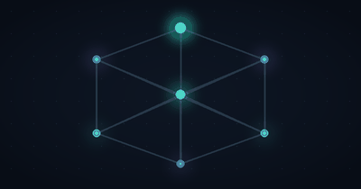

# hey, i'm ginno.

**computer science · artificial intelligence · data**

I build things around machine learning, data, and software — from experimenting with models and NLP to turning ideas into working apps.

---

### a little about me

I'm a Computer Science student specializing in **AI**, based in the Philippines. I'm drawn to **machine learning, NLP, computer vision, and data analytics** — and I like building the APIs, interfaces, and tools that make those ideas useful.

### tech / toolbox

**AI & data**

**Development & tools**

---

### github / at a glance

<picture>
  <source media="(prefers-color-scheme: dark)" srcset="./assets/overview.dark.svg">
  
</picture>

### contributions / the last year

<picture>
  <source media="(prefers-color-scheme: dark)" srcset="./assets/contributions.dark.svg">
  
</picture>

### languages / public code

<picture>
  <source media="(prefers-color-scheme: dark)" srcset="./assets/languages.dark.svg">
  
</picture>

<strong>more / coding rhythm</strong>

 

<picture>
  <source media="(prefers-color-scheme: dark)" srcset="./assets/rhythm.dark.svg">
  
</picture>

---

keep exploring · keep building · keep learning

 

Dashboard metrics update weekly through GitHub Actions. Animated header is generated and stored in this repository.

