# ginno / ginnolmao

`ai` &nbsp;·&nbsp; `data` &nbsp;·&nbsp; `code`

*building, experimenting, and learning along the way.*

<a href="https://profile-arostique.vercel.app/">website</a> &nbsp;·&nbsp; <a href="https://github.com/GinnoLmao?tab=repositories">repositories</a>

---

### github / overview

<picture>
  <source media="(prefers-color-scheme: dark)" srcset="./assets/overview.dark.svg">
  
</picture>

### contributions / last 12 months

<picture>
  <source media="(prefers-color-scheme: dark)" srcset="./assets/contributions.dark.svg">
  
</picture>

### languages / public repositories

<picture>
  <source media="(prefers-color-scheme: dark)" srcset="./assets/languages.dark.svg">
  
</picture>

<strong>activity / coding rhythm</strong>

 

<picture>
  <source media="(prefers-color-scheme: dark)" srcset="./assets/rhythm.dark.svg">
  
</picture>

---

  Metrics refresh weekly via GitHub Actions · The numbers reflect GitHub activity, not a résumé.

